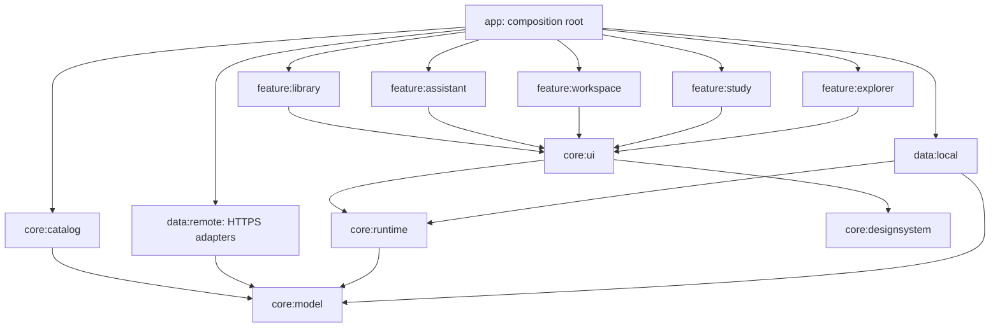

# Native Android architecture

Current PDF harness: PDF_HARNESS.md. Native source-linked topic compositions span imported PDFs and insert sections into the current reading page. Model-directed tool discovery, serializer-derived execution schemas and captured source-proof binding preserve runtime authority. Native placement graphs retain original ownership/cursors/learner records; source/chat/original controls remain compact and on demand. Current checkpoint: 427 passing unit tests; 13 modules / 369 focused production files. Full live Cell/supplement mapping/extraction/inline composition/Gemini orchestration/Room recovery passed (138.592 seconds), with separate layout/guide/enlargement/keyboard/storage tablet checks. Historical counts/status below describe earlier checkpoints.

Current provider architecture: DIRECT_PROVIDER_ARCHITECTURE.md. User keys are encrypted with Android Keystore; Android calls Gemini/Groq directly and performs selected-page extraction, original figure cropping and Room caching locally. Hosting and server-only keys described in older sections are superseded.

Current recovery policy: COLD_SOURCE_RECOVERY.md. Saved workspace structure is validated independently of source-cache availability. Valid learner records retain original source references; unavailable references are exposed to UI/AI. New AI source-based content still requires readable source evidence, and actual source navigation remains guarded. Library/cache failures do not skip the independent workspace restore. Damaged source stores remain preserved and write-protected until the explicit native repair flow in SOURCE_CACHE_REPAIR.md. Shared check/dismiss actions expose metadata only; learner-only confirmation makes a verified private backup before a stale-guarded Room transaction repairs damaged rows.

This is an implemented architecture foundation with a runnable Compose home, chapter PDF libraries, explorer and workspace. It is not the finished PDF/Gemini product. The earlier React app remains a separate prototype; Android does not embed it.

## Dependency direction



The app assembles concrete dependencies. Features never depend on one another, persistence implementations, provider SDKs or the application. Core model/runtime compile as ordinary Kotlin/JVM modules without Android. The checked module policy is in `architecture/module-boundaries.json`; run `python tools/check_architecture.py` from this directory to enforce it. Production Kotlin files have a 200-line review limit and one focused concern per file.

## Module ownership

| Module | Owns | Cannot own |
|---|---|---|
| core:model | Source/chapter/page models, independent activities and visual instances, command protocol, preferences and adapter interfaces | Compose, Android APIs, provider code |
| core:catalog | NEET 2026 subject/chapter metadata and provenance | UI, network or storage |
| core:runtime | Registries, transactional commands, category handlers, navigation, layout solving, interactions, undo, snapshot coordination and page-engineering validation/cache orchestration | UI rendering or network requests |
| core:designsystem | Color/typography/spacing tokens, theme, surface and accessible action primitives | Source data or AI semantics |
| core:ui | Renderer contract/registry, prebuilt motion, gesture adapters and interaction modifiers | Specific study features |
| data:remote | Direct Gemini/Groq HTTPS adapters, serializer-derived mentor response schema and response checks | Secret persistence, UI or direct workspace mutation |
| data:local | Room workspace/library records, legacy recovery, PDF import/rendering, source-catalog and bounded source-media adapters | Layout decisions or component rendering |
| feature:assistant | Separate connection editor, composer, conversation and status surfaces | Network, secret storage or direct state mutation |
| feature:library | Home, subject search, chapter libraries, original PDF viewer and appearance settings | Direct provider or persistence calls |
| feature:study | Separate reader/paragraph, quiz, recall, explanation, table and source-image renderer files | Direct provider or persistence calls |
| feature:workspace | Canvas, reusable component hosts/toolbars and activity capsules | Feature-specific renderers or semantic AI decisions |
| feature:explorer | Capability catalog, motion playground and accepted/rejected command inspection | Production learning workflows |
| app | Application/activity entry points, dependency graph, route state, ViewModel and labelled fixtures | Monolithic feature implementations |

Saved-note ownership: SAVED_NOTES.md. The library projects existing reader annotations/drafts; only native fingerprinted commands mutate drafts. Provider context redacts private draft content/identities and local notes search; saved annotation navigation retains source and pin guards.

Search projection: STUDY_SEARCH.md. Cached source enumeration and a cancellable background native search session project owned metadata/content into bounded results. Native target reconstruction/fingerprints and existing source/pin/history handlers validate opens. Only current results enter provider context; query/internal library snapshots and private drafts are redacted.

Bounded orchestration: ASSISTANT_CONTINUATION.md. The native session can use three fresh rounds under one user intent, with per-batch validation and acknowledged partial progress. Separate request/round/conversation/policy files retain source, pin, writing and retry protections. Platform effects wait rather than implying external completion; unsafe replay is disabled.

## Prebuilt interface architecture

`ComponentContract` describes dimensions, presentations, actions, gestures, motion, persisted state and accessibility. The pure capability registry and Compose renderer registry are separate; the composition root verifies complete one-to-one coverage. A feature adds an engineer-written renderer, not an executable model-generated string.

`ComponentInstance` refers to an independently persisted `Activity`. Multiple visual instances can refer to one activity. Hidden components retain answers, notes and diagram transforms. Activity handlers own creation and suspension; presentation handlers own visibility/priority/presets; navigation handlers own source changes. Adding a command family means adding its handler and tests, not appending everything to the entry point.

The layout solver constructs source-related groups, attaches inline enrichments to the matching reader, orders pins/focus/priorities, and allocates columns using real minimum sizes and weighted remaining space. Narrow viewports stack; capsules use the activity strip. DOMINANT uses a full-width composition; INLINE uses the same renderers within the reader group. Float/overlay relations and user-resizable dividers are future additions and are not advertised by current contracts.

## Motion, gesture and interaction separation

- MotionRegistry contains fade, expand, slide and focus presets. RegisteredMotion executes prebuilt Compose visibility/content-size transitions. Explicit reduced motion resolves all durations to zero; Compose also receives the system animation scale. FOCUS currently uses a short fade; shared-element/focus-highlight movement remains future work.
- GestureRegistry declares capabilities and conflict policy. Actual platform scroll and SelectionContainer keep native behavior. RegisteredTransform supplies bounded diagram pinch/pan; explicit zoom controls offer an accessible alternative. RegisteredTap provides a labelled, policy-gated click modifier. LONG_PRESS has a policy definition but is not advertised by the five current components; drag, swipe, custom long press and stylus adapters remain future work.
- LearningInteraction / LearningReducer own answer selection, submission, reading position, pins and diagram transform events. They execute locally; no cloud call enters a gesture or animation loop.
- Attention policy rejects AI commands during protected user interaction unless explicitly requested. Pin protection is enforced independently. The native mentor adapter now connects through AssistantViewModel and AssistantSession to the shared runtime. Revision/library guards and pin protection are active; complete native text-selection/writing lock wiring remains outstanding.

## Execution and recovery

AppActionRegistry exposes stable semantic actions and supported arguments. AppCapabilityContext exports actual curriculum/library IDs, preferences, navigation, study context and revision. Touch controls and future AI use AppCommandBatch through the same AppCommandExecutor. Effects such as opening the OS PDF picker are emitted only after an entire batch validates. Strict command decoding rejects unknown fields and discriminator values. CommandExecutor applies a batch to immutable state and commits only after all commands succeed. Source/capability/content checks and stale-revision checks run first. Traces are separate from learning state. The renderer accepts only registered implementations.

WorkspaceSession serializes command and interaction state updates. SnapshotWriter conflates rapid gesture snapshots and serializes durable writes outside the state mutex; backgrounding requests a flush. Room transactions persist the current workspace and library metadata; AtomicFile is retained for legacy recovery. Unsupported/corrupt recovery is reported and original files are preserved instead of overwritten. Layout undo changes presentation only and never rolls back answers or navigation history.

The Room workspace adapter stores versioned snapshots and awaits durable writes for answers and other critical actions. Rapid reading positions and transforms are conflated. Legacy snapshots are recovered without replacing corrupted originals. Individual engineered-source/annotation repositories and abrupt-process device verification remain ahead; a newest transient gesture can be lost if the process stops before its write completes.

## PDF and AI boundaries

SourceCatalog, PageRepository, PageEngineer, PdfTools, MentorProvider and VoiceGateway are explicit ports. EngineeringCoordinator checks the page cache and serializes duplicate work per page. PageModelValidator checks IDs, source regions, parent cycles and relationships, and rejects a provider trying to mark its own transcript reviewed or supply approved corrections. Completed jobs return a page; they never mutate the currently focused UI themselves.

ReadingCompiler converts source elements and separately approved corrections into stable reading blocks. Real imported PDF bytes remain private and immutable. Native PdfRenderer displays original pages, with page selection and bounded zoom/pan. Imported metadata joins the live source catalog; fixtures remain in the explorer. Selected-page Gemini reconstruction, deterministic extraction/crops and fidelity reconciliation are planned next. No OCR implementation was added here. No provider keys or fake Gemini behavior is included. data:remote now implements a bounded HTTPS mentor adapter, strict request/response versions and revision checks; AssistantViewModel activates it only from privately saved service settings. AES-GCM/Android Keystore credentials reside outside backup storage; the normal INTERNET permission allows HTTPS calls and cleartext is disabled. The separate service/ package implements authenticated Gemini and Groq endpoints. Selected-page engineering and native audio capture remain pending.

## Adding one feature

1. Define typed data and durable state in model; add/update an adapter port only when needed.
2. Write pure validations, actions and tests in runtime.
3. Add one capability contract and a renderer inside its feature package.
4. Use shared tokens, primitives and registered interactions/motion. Do not hardcode an AI provider inside it.
5. Register the renderer in the composition root; registry coverage and dependency checks must pass.
6. Inspect it through the explorer and test its coexistence, suspension/recovery, keyboard/touch and reduced motion.

## Build and verification

Open this `android/` directory in Android Studio. It retains the existing AGP 9.4.1 / Gradle 9.6 scaffold and uses built-in Android Kotlin with a matching 2.2.10 Compose compiler plugin. Library versions are centralized in the version catalog; every module has its own explicit dependencies. No unnecessary DI framework or runtime frontend generation is introduced.

```powershell
.\gradlew.bat :core:catalog:test :core:runtime:test :data:local:testDebugUnitTest :app:assembleDebug :app:assembleDebugAndroidTest :app:lintDebug exportDebugApk
python tools/check_architecture.py
```

The exported debug APK is `artifacts/folio-debug.apk`. It launches home and chapter libraries and imports/views real PDFs. UI explorer exercises labelled fixture components; live Gemini/Groq, page reconstruction and the complete component catalogue are still pending. Current verification: 38 executed unit tests pass; app/instrumentation APK builds and lint pass. Three instrumentation tests also pass on the connected Android 14 tablet, covering native quiz pause/resume, PDF import/rendering and Room recovery. The exported app was separately installed, cold-launched and its home screen inspected. Broader lifecycle/accessibility/performance checks remain pending; the emulator still lacks its Windows hypervisor driver. Build output uses Gradle's private cache for OneDrive checkouts.

Sources used for build configuration and boundaries: [AGP built-in Kotlin](https://developer.android.com/build/migrate-to-built-in-kotlin), [Compose compiler setup](https://developer.android.com/develop/ui/compose/setup-compose-dependencies-and-compiler), [Android modularization](https://developer.android.com/topic/modularization/patterns).

Latest assistant integration evidence: PHASE_2_PROGRESS.md. Current architecture has 13 modules / 181 focused main Kotlin files; debug-only test hosts are separate from production components. Native request/result ports never contain provider keys.

## Native engineered-source cache

Room version 2 adds source_pages with checksum/document/page/compiler-version identity and separate fidelity payloads. SourceCacheMigration adds the table without dropping existing workspace/library data; schemas 1 and 2 are exported. data:local intentionally depends on the Android-free runtime validator so both fresh saves and recovered machine pages receive the same structure/bounds checks. Corrupt recovery preserves rows and disables overwrite rather than publishing partial source data.

AppGraph connects RemotePageEngineer, bounded atomic original-image storage and RoomPageRepository through EngineeringCoordinator. source.engineer_page is a registered AppCommand that emits a validated background effect; Android touch and Gemini use the same handler. PageEngineeringViewModel limits concurrent work and publishes cache results without source navigation. Cache revision updates invalidate source/image rendering without replacing remembered UI state. The reader displays original images, machine UNCHECKED status and separate fidelity counts. Complete live-host/provider/device source-fidelity validation remains outstanding.

## Foreground voice boundary

core:model owns the audio/transcription port and serializable VoiceInputState. data:local owns Android microphone capture; data:remote owns private HTTPS audio upload. VoiceInputViewModel coordinates capture, cancellation and transcription in the app module. VoiceTranscriptRouter owns review/automatic handoff and preserves rejected drafts. The feature:assistant panel/status bar/mode control receive state/callbacks without importing either data implementation. OS permission is requested by the app, and backgrounding cancels active recording/transcription. Shared voice.start/finish/cancel commands emit effects only after the full batch validates; voice.auto_send changes only the persisted submission preference. Reviewed or automatically forwarded transcripts use the existing Gemini command path. Continuous listening and spoken replies remain outstanding.


Native preparation orchestration: PAGE_PREPARATION_CONTINUATION.md. App-owned PagePreparationJobs shares bounded work between page controls and assistant. PagePreparationAwaiter only supports engineering effects; target/input/library changes cancel further planning, while queued jobs only cache. The next assistant request recaptures actual source/fidelity. Wire geometry v2 declares normalized YXYX boxes, with strict native conversion to retained PDF-point regions.

Visual organization: UI_REDESIGN.md. Responsive sidebar/bottom chrome and secondary menus dispatch existing typed actions with stable semantic IDs. Native dashboard, recent-document cards, PDF page tools and theme/press primitives stay separate from runtime/provider code. Reduced-motion preferences reach the shared theme. User development directives are preserved under development/requirements and take priority over historical backend descriptions.


Document study: DOCUMENT_STUDY.md. STUDY is a full-window document workflow with a persistent companion, separate from the canvas workspace. Native checksum-keyed topic-map ports/AtomicFile adapter and bounded original-PDF batch mapping feed shared typed selection/preparation/guide actions. Persisted plans own selected ranges and native guide versions; existing source caches and reading confirmations retain authority. Native workers only publish/cache results. Model topic summaries are provisional, not original wording. Earlier helper rejection is resolved. Current harness/UI acceptance and the remaining full live composition gap are recorded in PDF_HARNESS.md.
